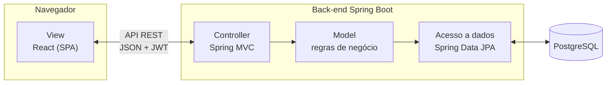
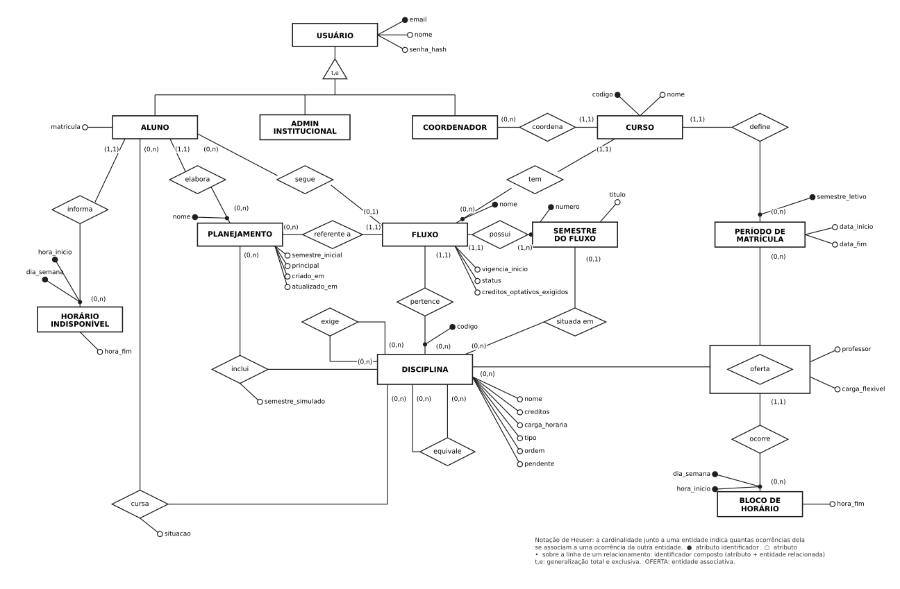

# Arquitetura — base para o desenvolvimento

> Consolida o [Documento de Arquitetura entregue](originais/documento-de-arquitetura.pdf) com as decisões de [revisao-de-discrepancias.md](revisao-de-discrepancias.md). Onde houver diferença, vale este arquivo. As HUs citadas estão em [historias-de-usuario.md](historias-de-usuario.md).

## 1. Visão geral

Sistema **Fluxograma Interativo para Planejamento Acadêmico** (cliente Alicia Paiva). Três atores — Aluno, Coordenador e Admin Institucional — e suporte a vários cursos (esta versão usa só Computação). Sem integração com o SISACAD: o aluno informa o próprio histórico, e "matrícula" significa **planejar** a matrícula do período, nunca efetivá-la.



| Decisão | Escolha | Justificativa |
|---|---|---|
| Padrão arquitetural | Cliente-servidor em 3 camadas, MVC web | Separa interface, regra de negócio e dados |
| Integração | API REST em JSON, sem estado | Simples e natural para a web |
| Implantação | Monolito | Time único, mesmo repositório |
| Front-end | React (SPA) | Recálculo imediato do fluxograma e da simulação no navegador (HU09, HU10, HU20) |
| Back-end | Java + Spring Boot | Domínio da equipe; ecossistema maduro para REST, JPA e segurança |
| Banco de dados | PostgreSQL | Domínio relacional; restrição de exclusão para períodos sobrepostos (HU02) |
| Autenticação | JWT com o papel no token | API sem estado e controle por ator |
| Documentação da API | OpenAPI com springdoc-openapi, em `/swagger-ui` | Contrato sempre atualizado |
| Ambiente | Docker Compose (Spring Boot + PostgreSQL), depois do MVP; até lá, execução local sem Docker (seção 6) | Ambiente idêntico para todos; o MVP roda só com Java e Node |

Dentro do back-end, cada camada só usa a imediatamente inferior. Microsserviços continuam descartados.

## 2. Autenticação e autorização

- Papéis: `ALUNO`, `COORDENADOR`, `ADMIN_INSTITUCIONAL` (generalização total e exclusiva de USUÁRIO).
- **Admin Institucional:** cursos, coordenadores e períodos de matrícula, e também **todas as ações do coordenador em qualquer curso** (HU01, tabela de atores).
- **Coordenador:** fluxos, semestres, disciplinas, equivalências e ofertas **do curso ao qual está vinculado**. Fora dele: 403.
- **Aluno:** só os próprios dados (fluxo, marcações, planejamentos, horários indisponíveis). Dados de outro aluno: 403.
- Cadastro do aluno: matrícula, nome, e-mail e senha (HU22). Login: e-mail **ou** matrícula + senha.
- Senha com no mínimo 8 caracteres (cadastro do aluno e senha inicial do coordenador). O token JWT vale 8 horas; depois disso, novo login.
- Coordenadores são criados pelo admin (HU01). O primeiro admin é inserido por migração de dados iniciais.
- Recuperação de senha está fora desta versão (o link foi removido do protótipo).

## 3. Modelo de dados



**Leitura (Heuser):** a cardinalidade escrita junto a uma entidade indica quantas ocorrências **dela** se associam a uma ocorrência da outra. Ex.: em COORDENADOR (0,n) — coordena — (1,1) CURSO, um curso tem 0..n coordenadores e um coordenador coordena exatamente 1 curso. ● identificador, ○ atributo, • sobre a linha = identificador composto (atributo + entidade relacionada), *t,e* = generalização total e exclusiva.

### 3.1 Decisões de modelagem

- **Estado da disciplina.** Só *Cursada* e *Cursando* são guardados (`cursa.situacao`). *Disponível* e *Bloqueada* são calculados (seção 5). Trancada/reprovada = apagar a linha de `cursa` (HU19).
- **Tipos de disciplina** (`disciplina.tipo`):
  - `OBRIGATORIA` — tem semestre e posição (`ordem`) na linha do semestre;
  - `OPTATIVA` — sem semestre: fica no catálogo de optativas (no CSV usa o semestre 99); `ordem` é a posição no catálogo;
  - `EXTERNA` — pré-requisito que não pertence ao fluxo (ex.: CT904, CC091). Não tem semestre, não aparece nas linhas do fluxograma e não conta no progresso. O aluno a marca como `CURSADA` para indicar que cumpriu o pré-requisito (HU09). `pendente = true` quando veio de um código não encontrado no CSV: vira aviso no editor até o coordenador confirmá-la como externa ou corrigir o pré-requisito (HU03, HU20).
- **Semestre do fluxo.** Entidade fraca (fluxo, número) com título ("Fundamentos", "Bases"…). Aceita qualquer quantidade de disciplinas, exibidas lado a lado na `ordem` definida no editor; o fluxograma do aluno usa a mesma ordem (HU20, comentário do professor).
- **Carga horária.** Armazenada em `disciplina.carga_horaria` (não é calculada a partir dos créditos).
- **Fluxo.** `status` = `RASCUNHO` ou `PUBLICADO`; `vigencia_inicio` = semestre letivo em que a matriz passa a valer. Rótulos calculados para fluxos publicados, a partir do *semestre letivo atual* do curso (o do período de matrícula aberto ou, se não houver, o do último período já iniciado):
  - **Prévia:** vigência ainda não começou;
  - **Vigente:** o de vigência mais recente já iniciada;
  - **Em acompanhamento:** os demais.
  Rascunhos só aparecem para a coordenação. A seleção inicial do aluno (HU06) lista Vigente e Em acompanhamento; a simulação de troca (HU12) lista também Prévia.
- **Créditos exigidos.** `fluxo.creditos_optativos_exigidos` em créditos. Total exigido = soma dos créditos das obrigatórias + créditos optativos exigidos (fluxo 2023.1: 178 + 16 = 194).
- **Pré-requisitos e equivalências.** Auto-relacionamentos N:N de DISCIPLINA. Em *exige*, todos os pré-requisitos precisam estar cumpridos (relação "E"). *Equivale* é simétrico, liga disciplinas de fluxos diferentes e não aceita par repetido.
- **Período de matrícula.** Pertence a um curso; único por (curso, semestre letivo) e sem datas sobrepostas no mesmo curso (restrição de exclusão do PostgreSQL).
- **Oferta.** Entidade associativa DISCIPLINA × PERÍODO, no máximo uma por par (sem turmas paralelas). `professor` guarda professor ou responsável; `carga_flexivel = true` para atividades sem horário (AACC, extensão). Blocos de horário: 0..n, sendo zero só com carga flexível.
- **Horários.** BLOCO DE HORÁRIO e HORÁRIO INDISPONÍVEL usam o mesmo formato (dia da semana, hora de início, hora de fim), o que permite detectar conflitos (HU16, HU17).
- **Planejamento.** Nome único por aluno; no máximo um `principal` por aluno; `semestre_inicial` é o semestre letivo do 1º semestre simulado; `criado_em`/`atualizado_em`. *inclui* guarda o `semestre_simulado` (1 = `semestre_inicial`) de cada disciplina. O planejamento aponta para o fluxo em que foi montado, o que permite planejar num fluxo simulado (HU12).
- **Semestres já concluídos.** O sistema não guarda quando cada disciplina foi cursada. Nas telas de simulação e previsão, as cursadas são agrupadas pelo semestre do fluxo e rotuladas para trás a partir de `semestre_inicial` (ex.: 2026.1, 2025.2…).
- **Matrícula do período.** É o semestre do planejamento escolhido que cai no período aberto (HU14). "Salvar rascunho" e "Confirmar seleção" gravam o mesmo dado (o semestre no planejamento); confirmar só é aceito sem conflitos (HU16).
- **Troca de fluxo (HU13).** Atualiza `aluno.fluxo_id` e cria em `cursa` as marcações das disciplinas equivalentes no novo fluxo. As marcações do fluxo anterior são mantidas, mas deixam de ser exibidas; planejamentos antigos continuam ligados ao fluxo em que foram montados.
- **Usuários.** USUÁRIO concentra as credenciais (e-mail único). ALUNO tem matrícula única e fluxo opcional (0..1) até a HU06.

### 3.2 Esquema relacional

PK = chave primária; FK = chave estrangeira.

| Tabela | Colunas e restrições |
|---|---|
| `usuario` | **id** PK, email (único), nome, senha_hash, papel |
| `aluno` | **usuario_id** PK/FK, matricula (única), fluxo_id FK (anulável) |
| `coordenador` | **usuario_id** PK/FK, curso_id FK |
| `admin_institucional` | **usuario_id** PK/FK |
| `curso` | **id** PK, codigo (único), nome |
| `fluxo` | **id** PK, curso_id FK, nome, vigencia_inicio, status (`RASCUNHO`/`PUBLICADO`), creditos_optativos_exigidos; único (curso_id, nome) |
| `semestre_fluxo` | **fluxo_id** FK, **numero**, titulo; PK (fluxo_id, numero) |
| `disciplina` | **id** PK, fluxo_id FK, codigo, nome, creditos, carga_horaria, tipo (`OBRIGATORIA`/`OPTATIVA`/`EXTERNA`), semestre (anulável; FK (fluxo_id, semestre) → semestre_fluxo; obrigatório só para OBRIGATORIA), ordem, pendente; único (fluxo_id, codigo) |
| `pre_requisito` | **disciplina_id** FK, **requisito_id** FK; PK composta |
| `equivalencia` | **disciplina_id** FK, **equivalente_id** FK; PK composta; disciplinas de fluxos diferentes; par não repetido em nenhuma ordem |
| `periodo_matricula` | **id** PK, curso_id FK, semestre_letivo, data_inicio, data_fim; único (curso_id, semestre_letivo); sem sobreposição de datas por curso |
| `oferta` | **id** PK, disciplina_id FK, periodo_id FK, professor, carga_flexivel; único (disciplina_id, periodo_id) |
| `bloco_horario` | **id** PK, oferta_id FK, dia_semana, hora_inicio, hora_fim; único (oferta_id, dia_semana, hora_inicio) |
| `horario_indisponivel` | **id** PK, aluno_id FK, dia_semana, hora_inicio, hora_fim; único (aluno_id, dia_semana, hora_inicio) |
| `cursa` | **aluno_id** FK, **disciplina_id** FK, situacao (`CURSANDO`/`CURSADA`); PK composta |
| `planejamento` | **id** PK, aluno_id FK, fluxo_id FK, nome, semestre_inicial, principal, criado_em, atualizado_em; único (aluno_id, nome); no máximo um principal por aluno |
| `planejamento_disciplina` | **planejamento_id** FK, **disciplina_id** FK, semestre_simulado; PK composta |

### 3.3 Formato do CSV (HU03)

Separador `;`, UTF-8, até 5 MB, uma linha por disciplina, cabeçalho obrigatório:

```
codigo;nome;semestre;creditos;carga_horaria;pre_requisitos;optativa
```

- `semestre`: número do semestre; **99** para optativas;
- `pre_requisitos`: códigos separados por vírgula; pré-requisito externo com prefixo `EXT:` (ex.: `EXT:CT904`); vazio quando não há;
- `optativa`: `Sim` ou `Não`.

Exemplo parcial do fluxo 2023.1 (do protótipo): [exemplos/modelo-fluxo.csv](exemplos/modelo-fluxo.csv).

## 4. API REST

Todos os endpoints, exceto login e cadastro, exigem o token JWT. Coluna **Papel**: A = admin, C = coordenador (no próprio curso; o admin também pode), Al = aluno (só os próprios dados), Todos = qualquer usuário autenticado.

### 4.1 Autenticação

| Método | Endpoint | Papel | HU | Descrição |
|---|---|---|---|---|
| POST | `/auth/login` | público | HU22 | E-mail ou matrícula + senha; devolve o JWT com o papel |
| POST | `/auth/registro` | público | HU22 | Cadastro do aluno (matrícula, nome, e-mail, senha) |

### 4.2 Cursos, coordenadores e períodos

| Método | Endpoint | Papel | HU | Descrição |
|---|---|---|---|---|
| GET | `/cursos` | Todos | HU01, HU06 | Listar cursos |
| POST | `/cursos` | A | HU01 | Cadastrar curso |
| PUT, DELETE | `/cursos/{id}` | A | HU01 | Editar e remover curso |
| GET, POST | `/cursos/{id}/coordenadores` | A | HU01 | Listar; cadastrar coordenador (cria o usuário já vinculado) |
| GET | `/cursos/{id}/periodos-matricula` | Todos | HU02, HU14 | Listar períodos (`?aberto=true` devolve o período aberto, se houver) |
| POST | `/cursos/{id}/periodos-matricula` | A | HU02 | Definir período (409 se sobrepuser outro ou repetir o semestre letivo) |
| PUT, DELETE | `/periodos-matricula/{id}` | A | HU02 | Corrigir ou remover período |

### 4.3 Fluxos e editor (coordenador)

| Método | Endpoint | Papel | HU | Descrição |
|---|---|---|---|---|
| GET | `/cursos/{id}/fluxos` | Todos | HU06, HU12 | Listar fluxos com o rótulo calculado (aluno não vê rascunhos) |
| POST | `/cursos/{id}/fluxos` | C | HU03 | Criar rascunho do zero ou duplicando (`baseFluxoId`) |
| POST | `/cursos/{id}/fluxos/importacao/validacao` | C | HU03 | Validar CSV (multipart) sem gravar: pré-visualização, linhas válidas e erros com linha/campo |
| POST | `/cursos/{id}/fluxos/importacao` | C | HU03 | Criar rascunho a partir do CSV. Erro de formato → 422 e nada é criado; pré-requisito não encontrado vira disciplina externa pendente (aviso) |
| GET | `/fluxos/{id}` | Todos | HU08, HU20 | Fluxo completo: semestres, disciplinas, ordem, pré-requisitos |
| PUT | `/fluxos/{id}` | C | HU03 | Nome, vigência e créditos optativos exigidos |
| DELETE | `/fluxos/{id}` | C | HU03 | Remover fluxo que nenhum aluno segue |
| POST | `/fluxos/{id}/semestres` | C | HU20 | Adicionar semestre |
| PUT, DELETE | `/fluxos/{id}/semestres/{numero}` | C | HU20 | Renomear ou remover semestre (vazio) |
| POST | `/fluxos/{id}/disciplinas` | C | HU20 | Adicionar disciplina |
| PUT, DELETE | `/disciplinas/{id}` | C | HU20 | Editar (inclui semestre, ordem, tipo e pré-requisitos) ou remover; 409 ao remover disciplina já marcada por aluno |
| GET | `/fluxos/{id}/avisos` | C | HU20 | Avisos que impedem a publicação |
| POST | `/fluxos/{id}/publicacao` | C | HU20 | Publicar; 409 se houver avisos |

### 4.4 Equivalências e ofertas (coordenador)

| Método | Endpoint | Papel | HU | Descrição |
|---|---|---|---|---|
| GET | `/fluxos/{id}/equivalencias?outroFluxo={id}&busca=` | C | HU04 | Equivalências entre dois fluxos, com busca e paginação |
| GET, POST | `/disciplinas/{id}/equivalencias` | C | HU04 | Listar e cadastrar equivalências (409 se repetida ou do mesmo fluxo) |
| DELETE | `/disciplinas/{id}/equivalencias/{equivalenteId}` | C | HU04 | Remover (editar = remover + cadastrar) |
| GET | `/periodos-matricula/{id}/fluxos/{fluxoId}/ofertas` | Todos | HU05, HU14 | Ofertas do período para o fluxo (aluno só vê durante o período aberto) |
| PUT | `/periodos-matricula/{id}/fluxos/{fluxoId}/ofertas` | C | HU05 | Substituir o conjunto de ofertas (422 se faltar horário/carga flexível ou responsável) |

### 4.5 Aluno

| Método | Endpoint | Papel | HU | Descrição |
|---|---|---|---|---|
| PUT | `/alunos/{id}/fluxo` | Al | HU06, HU13 | Selecionar o fluxo inicial ou confirmar a troca |
| GET | `/alunos/{id}/fluxos/{fluxoId}/simulacao` | Al | HU12, HU13 | Aproveitadas por equivalência, pendentes e cursadas sem equivalência |
| PUT, DELETE | `/alunos/{id}/disciplinas/{discId}` | Al | HU07, HU09, HU18, HU19 | Marcar cursada/cursando (inclusive pré-requisito externo); DELETE desmarca |
| GET | `/alunos/{id}/fluxograma` | Al | HU08, HU15 | Estados, resumo (percentual, cursadas, cursando, disponíveis) e créditos optativos |
| GET | `/disciplinas/{id}` | Todos | HU09 | Detalhes e cadeia de pré-requisitos (antes e depois) |
| GET, POST | `/alunos/{id}/planejamentos` | Al | HU10, HU11 | Listar e salvar planejamentos |
| GET, PUT, DELETE | `/planejamentos/{id}` | Al | HU10, HU11, HU14, HU16 | Abrir, alterar (inclui nome, principal e "confirmar seleção") ou remover |
| GET | `/planejamentos/{id}/fluxograma` | Al | HU10 | Estados recalculados considerando os semestres simulados |
| GET | `/planejamentos/{id}/previsao` | Al | HU21 | Conclusão prevista e créditos concluídos, planejados e pendentes |
| GET | `/planejamentos/{id}/conflitos?periodoId=` | Al | HU16, HU17 | Conflitos entre disciplinas e com horários indisponíveis |
| GET, POST | `/alunos/{id}/horarios-indisponiveis` | Al | HU17 | Listar e cadastrar |
| PUT, DELETE | `/horarios-indisponiveis/{id}` | Al | HU17 | Editar ou remover |

### 4.6 Contrato e erros

Códigos: 200, 201, 204, 400 (requisição malformada), 401 (não autenticado), 403 (sem permissão ou recurso de outro usuário), 404, 409 (conflito: período sobreposto, equivalência repetida, publicação com avisos, remoção de disciplina marcada, confirmação com conflito de horário) e 422 (CSV ou oferta inválidos). Formato único de erro:

```json
{ "erro": "Pré-requisito CC999 não existe no arquivo",
  "detalhes": [ { "linha": 26, "campo": "pre_requisitos" } ] }
```

Exemplo (HU18):

```
PUT /alunos/42/disciplinas/317
{ "situacao": "CURSANDO" }
-> 200 OK
```

PUT e DELETE são idempotentes.

## 5. Regras de cálculo

- **Disponível:** não está cursada nem cursando e **todos** os pré-requisitos (inclusive externos) estão `CURSADA`. Caso contrário, **Bloqueada**.
- **Simulação (HU10):** no semestre simulado *k*, contam como concluídas as cursadas, as cursando e as selecionadas nos semestres 1..*k*−1. Selecionáveis = disponíveis segundo essa regra, inclusive optativas.
- **Optativas (HU15):** créditos optativos cursados + planejados, comparados com `creditos_optativos_exigidos`.
- **Previsão (HU21):** conclusão = semestre letivo do último semestre simulado; pendentes = total exigido − (concluídos + planejados).
- **Conflito de horário (HU16, HU17):** dois blocos no mesmo dia com `inicio1 < fim2` e `inicio2 < fim1`. Carga flexível não conflita.
- **Avisos do editor (HU20):** disciplina no mesmo semestre ou em semestre anterior ao de um pré-requisito; pré-requisito vindo do CSV que não foi encontrado (disciplina externa pendente).

## 6. Ambiente

**Agora (MVP): execução local, sem Docker.** Basta Java 21 e Node.js 20 ou mais novo; os comandos estão no README.

- **API:** `./mvnw spring-boot:test-run` (Maven Wrapper, sem instalar o Maven) sobe o Spring Boot com um PostgreSQL embutido, o mesmo dos testes de integração, com os dados em `~/.aps-fluxograma/pg-dados`. Com um PostgreSQL próprio: `./mvnw spring-boot:run` e as variáveis `DB_URL`, `DB_USUARIO` e `DB_SENHA`.
- **Front-end:** `npm run dev` (Vite), que repassa `/api` para a API na porta 8080.
- **Dados de desenvolvimento:** o perfil `dev`, padrão, cria o curso CC, o fluxo 2023.1 lido de `docs/exemplos/modelo-fluxo.csv`, um admin, um coordenador e uma aluna de demonstração com os semestres 1 a 4 cursados. As senhas valem só para desenvolvimento e estão no README; em produção usa-se o perfil `prod`, sem esses dados.
- **Windows:** a API guarda os sockets locais do Java em `~/.aps-fluxograma/sockets`, porque em algumas máquinas a pasta temporária do sistema impede o servidor web de subir.

**Depois: Docker Compose.** Um container Spring Boot, um PostgreSQL e o front-end servido junto, para todos rodarem o projeto do mesmo jeito sem instalar JDK e Postgres.

## 7. Entregas

- **MVP — jornada do aluno:** HU22 (criar conta e entrar), HU06 (escolher o fluxo), HU07 (marcar cursadas), HU08 (matriz com estados e resumo), HU09 (detalhes e modo foco) e HU18/HU19 (cursando, desmarcar). No MVP o admin existe só nos dados de desenvolvimento; a migração do primeiro admin (seção 2) entra com as telas do admin.
- **Próximas:** telas do coordenador e do admin (HU01 a HU05, HU20), simulação, planejamentos e previsão (HU10, HU11, HU21), troca de fluxo (HU12, HU13), matrícula do período e horários (HU14 a HU17) e a dockerização.
